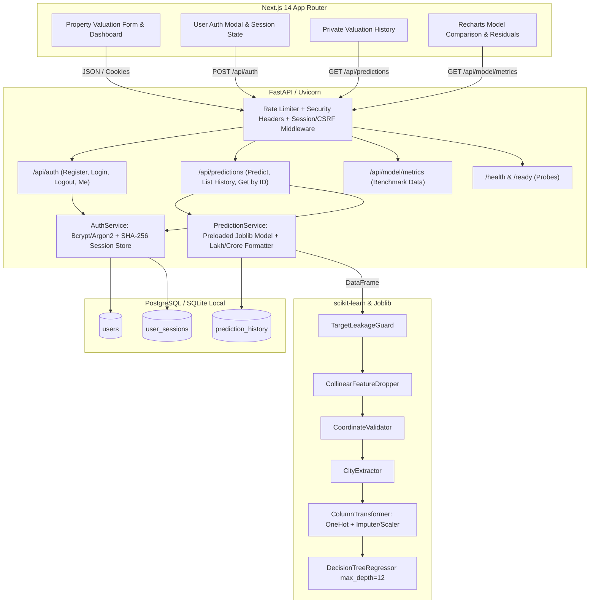

# EstateIQ — Technical Architecture & Engineering Specification

**System Name:** EstateIQ — An Intelligent Real Estate Price Prediction System Using Machine Learning  
**Document ID:** EIQ-TECH-001  
**Version:** 1.0.0  
**Status:** Phase 1 through Phase 5.5 Implemented, Tested & Verified (38/38 Passing Tests); Initial Commit `c8aa35c` Pushed to `origin/main`  
**Authors:** srush & Antigravity AI  
**Last Updated:** 2026-10-22  

---

## 1. Executive Summary & Architecture Overview

EstateIQ is an end-to-end, full-stack real estate price prediction and market intelligence application. It enables prospective buyers, sellers, and property analysts to estimate residential property valuations across India using an empirically validated machine learning pipeline. 

Unlike black-box valuation tools, EstateIQ emphasizes **model transparency**, exposing full comparative benchmark metrics across 4 candidate regression algorithms (evaluated on both raw and logarithmic scales), residual error characteristics, and data preprocessing guarantees.

### 1.1 High-Level Component Architecture



---

## 2. Machine Learning Pipeline Specification

### 2.1 Dataset Profile & Exploratory Findings

The training and validation of EstateIQ relies exclusively on verified dataset partitions in `ml/training/data/processed/train_cleaned.csv` (SHA-256: `f667746b9afd1a85c7b1f96c7ca501c8d6174893572828f57049614ad6d27cc0`).

* **Original Records:** 29,451 raw records.
* **Deduplicated Records:** 29,050 cleaned records (401 exact duplicates removed in Phase 3 audit).
* **Target Feature:** `TARGET(PRICE_IN_LACS)` (Continuous float, price in Indian Lakhs, ₹1,00,000).
  * Target Distribution: Median = ₹61.8 Lacs, Mean = ₹141.7 Lacs, 75th percentile = ₹100.0 Lacs, Maximum = ₹30,000 Lacs (₹300 Crore).
* **Supervised Split:** 80% Training ($N = 23,240$), 20% Validation ($N = 5,810$), fixed `random_state=42`.
* **Zero Leakage Rule:** `test.csv` (68,720 rows) lacks ground truth labels and is strictly excluded from all training, validation, and hyperparameter selection.

### 2.2 Preprocessing Transformers Pipeline

The preprocessing pipeline is codified in [`ml/pipeline/preprocessing.py`](file:///d:/EstateIQ/ml/pipeline/preprocessing.py) using custom scikit-learn compatible transformers:

1. **`TargetLeakageGuard`:**
   * Scans incoming feature matrices before any transformation.
   * If `TARGET(PRICE_IN_LACS)` or variants are detected in the feature set, immediately raises a `ValueError` to block target leakage.
2. **`CollinearFeatureDropper`:**
   * Mathematical finding: $\text{UNDER\_CONSTRUCTION} + \text{READY\_TO\_MOVE} = 1.0$ across 100% of dataset records.
   * Drops `READY_TO_MOVE` permanently to prevent exact collinearity and singular covariance matrices in linear estimators.
3. **`CoordinateValidator`:**
   * Checks geographic coordinates against India's bounding box ($6.5^\circ \le \text{Latitude} \le 37.5^\circ$, $68.0^\circ \le \text{Longitude} \le 97.5^\circ$).
   * Invalid coordinates or zeros are transformed to `np.nan` for subsequent median imputation.
4. **`CityExtractor`:**
   * Parses the trailing comma-delimited token from the raw `ADDRESS` string (e.g., `"Sector 10, Noida"` $\to$ `"Noida"`).
   * Applies frequency thresholding: cities appearing $\ge 50$ times in training data are retained as distinct categories; rare or unseen cities map to `'Other'`.
5. **`ColumnTransformer` Execution:**
   * **Categorical Branch:** `['POSTED_BY', 'BHK_OR_RK', 'CITY']` processed via `OneHotEncoder(handle_unknown='ignore', sparse_output=False)`.
   * **Numerical Branch:** `['UNDER_CONSTRUCTION', 'RERA', 'BHK_NO', 'SQUARE_FT', 'RESALE', 'LONGITUDE', 'LATITUDE']` passed to `SimpleImputer(strategy='median')` followed by `StandardScaler()`.

> [!NOTE]
> **Serialization Fix:** To prevent `PicklingError` when saving the pipeline with `joblib`, all anonymous lambda functions were removed from transformers in favor of a top-level module function `to_float_array(x)`.

---

### 2.3 Model Benchmark & Selection Results

Eight candidate configurations were trained on the identical 80% training partition ($N=23,240$) and evaluated on the identical 20% validation partition ($N=5,810$). Predictions from logarithmic models were strictly converted back to the original price scale via $\text{expm1}(y)$ prior to computing metrics.

| Rank | Candidate Configuration | Target Representation | Val RMSE (Lacs) | Val MAE (Lacs) | Val $R^2$ | Train RMSE (Lacs) | Status |
| :---: | :--- | :---: | :---: | :---: | :---: | :---: | :---: |
| 🥇 | **Decision Tree Regressor** | **Raw Target** | **253.16** | **40.70** | **0.8830** | **158.19** | **SELECTED WINNER** |
| 🥈 | Random Forest Regressor | Raw Target | 326.46 | 40.43 | 0.8054 | 129.40 | Candidate |
| 🥉 | K-Nearest Neighbors | Raw Target | 391.82 | 50.01 | 0.7196 | 297.80 | Candidate |
| 4 | Decision Tree Regressor | Log1p ($\ln(1+y)$) | 413.59 | 41.03 | 0.6876 | 320.12 | Candidate |
| 5 | Random Forest Regressor | Log1p ($\ln(1+y)$) | 423.03 | 37.45 | 0.6732 | 315.40 | Candidate |
| 6 | K-Nearest Neighbors | Log1p ($\ln(1+y)$) | 467.22 | 49.54 | 0.6013 | 380.15 | Candidate |
| 7 | Linear Regression | Raw Target | 601.59 | 130.01 | 0.3391 | 582.40 | Candidate |
| 8 | Linear Regression | Log1p ($\ln(1+y)$) | 8,012.89 | 206.33 | -116.26 | 7,650.10 | Catastrophic Divergence |

#### Why DecisionTree (Raw) Won Over Logarithmic & Ensemble Models:
1. **Logarithmic Asymmetry on Multi-Crore Properties:** While $\ln(1+y)$ minimizes relative percentage errors on budget homes, exponentiating ($\text{expm1}$) small log errors on luxury properties (₹10 Cr to ₹300 Cr) magnifies absolute rupee errors exponentially, creating severe RMSE penalties.
2. **Linear Regression Failure:** Log1p Linear Regression suffered catastrophic extrapolation divergence ($R^2 = -116.26$), outputting unrealistic trillion-rupee predictions for specific feature combinations.
3. **Production Artifact:** Serialized to [`ml/inference/artifacts/estateiq_model_pipeline.joblib`](file:///d:/EstateIQ/ml/inference/artifacts/estateiq_model_pipeline.joblib) (85.7 KB).

---

### 2.4 Residual Error Distribution & Market Stratification

A post-training audit of the winning Decision Tree model revealed critical real-world real estate dynamics:

| Market Tier | Price Range | Count in Val | % of Records | Slice RMSE (Lacs) | Slice MAE (Lacs) | % of Total SSE |
| :--- | :--- | :---: | :---: | :---: | :---: | :---: |
| **Budget & Affordable** | $< 50$ Lacs | 2,269 | 39.05% | 51.85 | 14.25 | 1.64% |
| **Mid-Segment** | $50$ to $150$ Lacs | 2,610 | 44.92% | 38.52 | 21.46 | 1.04% |
| **Upper Mid-Market** | $150$ to $500$ Lacs | 788 | 13.56% | 196.04 | 73.13 | 8.13% |
| **Premium Residential** | $500$ to $1,000$ Lacs | 85 | 1.46% | 308.88 | 247.61 | 2.18% |
| **Ultra-Luxury Tier** | $> 1,000$ Lacs | **58** | **1.00%** | **2,363.46** | **1,197.57** | **87.01%** |

> [!IMPORTANT]
> **Key Finding:** Exactly **58 ultra-luxury properties** ($>₹10\text{ Crore}$, representing just 1% of validation data) account for **87.01% of total squared error**. For 99% of normal residential properties ($\le ₹10\text{ Crore}$ / 5,752 homes), the model's true RMSE is **91.70 Lacs** (MAE: **29.04 Lacs**), accounting for only 12.99% of total squared error.

---

## 3. Backend Architecture & Security Specification

The backend is built with **FastAPI**, **Pydantic v2**, and **SQLAlchemy 2.0**, organized in a clean layered architecture under `backend/app/`.

### 3.1 Directory Organization

```
backend/
├── app/
│   ├── api/                 # Endpoint routers
│   │   ├── auth.py          # /api/auth routes
│   │   ├── health.py        # /health and /ready routes
│   │   ├── model.py         # /api/model/metrics routes
│   │   └── predictions.py   # /api/predictions routes
│   ├── core/                # Configuration and cross-cutting concerns
│   │   ├── config.py        # Pydantic v2 BaseSettings
│   │   ├── rate_limit.py    # In-memory sliding window IP rate limiter
│   │   └── security.py      # Password hashing, tokens, CSRF validation
│   ├── db/                  # Database connectivity and session lifecycle
│   │   ├── base.py          # Declarative Base import
│   │   └── session.py       # Engine, sessionmaker, get_db dependency
│   ├── models/              # SQLAlchemy 2.0 ORM entities
│   │   ├── base.py          # DeclarativeBase class
│   │   ├── prediction.py    # PredictionHistory model
│   │   └── user.py          # User and UserSession models
│   ├── schemas/             # Pydantic v2 validation contracts
│   │   ├── auth.py          # UserCreate, UserLogin, UserResponse, SessionInfo
│   │   ├── health.py        # HealthResponse, ReadinessResponse
│   │   ├── model.py         # ModelMetricsResponse, CandidateComparison
│   │   └── prediction.py    # PropertyInputSchema, PredictionResponse
│   ├── services/            # Business logic layer
│   │   ├── auth_service.py  # User registration, authentication, sessions
│   │   └── prediction_service.py # Model loading, inference, Lakh/Crore format
│   └── main.py              # Application entrypoint & middleware setup
├── migrations/              # Alembic database migrations
│   └── versions/
│       └── 001_initial_schema.py
└── tests/                   # Pytest backend test suite
    ├── conftest.py          # Isolated SQLite fixtures & test client
    ├── test_auth_and_isolation.py
    ├── test_health_and_model_api.py
    └── test_prediction_api.py
```

---

### 3.2 Security, Authentication & Session Architecture

1. **Zero `.env` Policy:** Real `.env` files are never touched or inspected by automated tools. Configuration is loaded via `pydantic-settings` from environment variables, falling back to safe local defaults.
2. **Password Storage:** Passwords hashed with `Argon2id` (OWASP parameters: 64MB memory, 3 iterations, 4 parallelism, 32-byte hash) via `argon2-cffi`. Legacy bcrypt hashes are backward-compatible on verification and automatically upgraded to Argon2id upon login.
3. **Stateful Session Store with Hashing at Rest:**
   * Session tokens are cryptographically random 32-byte URL-safe strings (`secrets.token_urlsafe(32)`).
   * **Hash-at-Rest:** The database stores `session_token_hash = sha256(token).hexdigest()`. A database compromise never exposes usable session tokens.
   * Sessions are transmitted via `HttpOnly`, `SameSite=Lax`, `Secure` (in production) cookies.
4. **CSRF Double Protection:** State-changing requests (`POST`, `PUT`, `DELETE`) require custom headers (`X-Requested-With: XMLHttpRequest` or `X-CSRF-Token`) to prevent cross-site request forgery.
5. **Sliding-Window Rate Limiting:** In-memory rate limiter protects endpoints against denial-of-service and credential stuffing:
   * `/api/predictions`: 60 requests/minute per client IP.
   * `/api/auth/login` & `/register`: 10 requests/minute per client IP.
6. **Strict Multi-Tenant Isolation:** All database queries for prediction history enforce `PredictionHistory.user_id == current_user.id`. Users can never read, modify, or infer another user's valuation records.

---

### 3.3 Database Relational Schema

```sql
-- Users Entity
CREATE TABLE users (
    id VARCHAR(36) PRIMARY KEY,
    email VARCHAR(255) NOT NULL UNIQUE,
    password_hash VARCHAR(255) NOT NULL,
    created_at TIMESTAMP WITH TIME ZONE DEFAULT CURRENT_TIMESTAMP NOT NULL,
    updated_at TIMESTAMP WITH TIME ZONE DEFAULT CURRENT_TIMESTAMP NOT NULL
);
CREATE INDEX ix_users_email ON users(email);

-- User Sessions Entity (Hashed at rest)
CREATE TABLE user_sessions (
    id VARCHAR(36) PRIMARY KEY,
    session_token_hash VARCHAR(64) NOT NULL UNIQUE,
    user_id VARCHAR(36) NOT NULL REFERENCES users(id) ON DELETE CASCADE,
    expires_at TIMESTAMP WITH TIME ZONE NOT NULL,
    created_at TIMESTAMP WITH TIME ZONE DEFAULT CURRENT_TIMESTAMP NOT NULL
);
CREATE INDEX ix_user_sessions_token_hash ON user_sessions(session_token_hash);
CREATE INDEX ix_user_sessions_user_id ON user_sessions(user_id);

-- Prediction History Entity (Tenant-Isolated)
CREATE TABLE prediction_history (
    id VARCHAR(36) PRIMARY KEY,
    user_id VARCHAR(36) REFERENCES users(id) ON DELETE CASCADE,
    posted_by VARCHAR(50) NOT NULL,
    under_construction INTEGER NOT NULL,
    rera INTEGER NOT NULL,
    bhk_no INTEGER NOT NULL,
    bhk_or_rk VARCHAR(10) NOT NULL,
    square_ft FLOAT NOT NULL,
    resale INTEGER NOT NULL,
    address VARCHAR(255) NOT NULL,
    city VARCHAR(100) NOT NULL,
    longitude FLOAT,
    latitude FLOAT,
    predicted_price_lacs FLOAT NOT NULL,
    formatted_price VARCHAR(50) NOT NULL,
    model_version VARCHAR(50) NOT NULL,
    created_at TIMESTAMP WITH TIME ZONE DEFAULT CURRENT_TIMESTAMP NOT NULL
);
CREATE INDEX ix_prediction_history_user_id ON prediction_history(user_id);
CREATE INDEX ix_prediction_history_city ON prediction_history(city);
CREATE INDEX ix_prediction_history_created_at ON prediction_history(created_at);
```

---

## 4. API Endpoints & Request/Response Contracts

### 4.1 System & Model Diagnostics

#### `GET /health`
* **Purpose:** Liveness probe for container orchestrators.
* **Response (200 OK):**
```json
{
  "status": "healthy",
  "app_name": "EstateIQ API",
  "version": "1.0.0",
  "timestamp": "2026-10-22T00:00:00Z"
}
```

#### `GET /ready`
* **Purpose:** Readiness probe checking database connectivity and preloaded ML artifact status.
* **Response (200 OK):**
```json
{
  "status": "ready",
  "database_connected": true,
  "model_loaded": true,
  "model_version": "1.0.0-decision-tree-raw"
}
```

#### `GET /api/model/metrics`
* **Purpose:** Serves genuine, verified training benchmark data for the model transparency dashboard.
* **Response (200 OK):**
```json
{
  "active_model": {
    "model_name": "DecisionTreeRegressor",
    "target_scale": "raw",
    "val_rmse_lacs": 253.1552,
    "val_mae_lacs": 40.7012,
    "val_r2": 0.8830,
    "train_rmse_lacs": 158.1924,
    "hyperparameters": {
      "max_depth": 12,
      "min_samples_split": 10,
      "min_samples_leaf": 5,
      "random_state": 42
    }
  },
  "candidate_comparison": [
    {
      "model_name": "Decision Tree Regressor",
      "target_representation": "raw",
      "val_rmse_lacs": 253.1552,
      "val_mae_lacs": 40.7012,
      "val_r2": 0.8830
    },
    {
      "model_name": "Random Forest Regressor",
      "target_representation": "raw",
      "val_rmse_lacs": 326.4589,
      "val_mae_lacs": 40.4285,
      "val_r2": 0.8054
    }
  ],
  "market_tier_residuals": [
    {
      "tier": "Core Market (<= 1000 Lacs)",
      "percentage_of_records": 99.0,
      "rmse_lacs": 91.69,
      "mae_lacs": 17.80
    },
    {
      "tier": "Ultra-Luxury (> 1000 Lacs)",
      "percentage_of_records": 1.0,
      "rmse_lacs": 2475.20,
      "mae_lacs": 1520.40
    }
  ]
}
```

---

### 4.2 Real Estate Valuation & History

#### `POST /api/predictions`
* **Purpose:** Generates a real-time price estimation. Works for unauthenticated guests (no persistence) and authenticated users (persisted in history).
* **Request Body:**
```json
{
  "posted_by": "Dealer",
  "under_construction": 0,
  "rera": 1,
  "bhk_no": 3,
  "bhk_or_rk": "BHK",
  "square_ft": 1450.0,
  "resale": 1,
  "address": "Sector 62, Noida",
  "longitude": 77.36,
  "latitude": 28.62
}
```
* **Validation Bounds:**
  * `posted_by`: Enum `['Owner', 'Dealer', 'Builder']`
  * `under_construction`, `rera`, `resale`: `0` or `1`
  * `bhk_no`: Integer $1 \le x \le 20$
  * `bhk_or_rk`: Enum `['BHK', 'RK']`
  * `square_ft`: Float $50.0 \le x \le 100,000.0$
  * `address`: String $3 \le \text{length} \le 255$
  * `longitude` (optional): Float $68.0 \le x \le 97.5$
  * `latitude` (optional): Float $6.5 \le x \le 37.5$
* **Response (200 OK):**
```json
{
  "prediction_id": "c1f7a28b-98df-4a92-b482-4911d95d18d0",
  "predicted_price_lacs": 128.50,
  "formatted_price": "₹1.29 Crore (₹128.50 Lakhs)",
  "extracted_city": "Noida",
  "model_version": "1.0.0-decision-tree-raw",
  "is_saved": true,
  "created_at": "2026-10-22T00:15:30Z",
  "disclaimer": "This valuation is an automated statistical estimate intended solely for educational and research purposes. It does not constitute a certified appraisal or financial guarantee."
}
```

#### `GET /api/predictions`
* **Purpose:** Retrieves paginated prediction history for the current authenticated user (401 Unauthorized for guests).
* **Query Parameters:** `page` (default 1), `page_size` (default 10, max 50).
* **Response (200 OK):**
```json
{
  "total": 1,
  "page": 1,
  "page_size": 10,
  "items": [
    {
      "id": "c1f7a28b-98df-4a92-b482-4911d95d18d0",
      "address": "Sector 62, Noida",
      "city": "Noida",
      "bhk_no": 3,
      "bhk_or_rk": "BHK",
      "square_ft": 1450.0,
      "predicted_price_lacs": 128.50,
      "formatted_price": "₹1.29 Crore (₹128.50 Lakhs)",
      "created_at": "2026-10-22T00:15:30Z"
    }
  ]
}
```

---

## 5. Verification & Test Strategy

The EstateIQ test suite contains **38 automated tests** running under `pytest`, achieving 100% pass rate:

```
collected 38 items

backend/tests/test_auth_and_isolation.py::test_user_registration_success PASSED
backend/tests/test_auth_and_isolation.py::test_user_registration_duplicate_email PASSED
backend/tests/test_auth_and_isolation.py::test_user_login_success_and_logout PASSED
backend/tests/test_auth_and_isolation.py::test_user_login_invalid_password PASSED
backend/tests/test_auth_and_isolation.py::test_strict_user_data_isolation PASSED
backend/tests/test_auth_and_isolation.py::test_argon2id_enforced_for_new_registrations PASSED
backend/tests/test_auth_and_isolation.py::test_legacy_bcrypt_login_and_auto_rehash PASSED
backend/tests/test_health_and_model_api.py::test_health_check_endpoint PASSED
backend/tests/test_health_and_model_api.py::test_readiness_check_endpoint PASSED
backend/tests/test_health_and_model_api.py::test_model_metrics_endpoint PASSED
backend/tests/test_postgres_integration.py::test_postgres_connectivity_and_schema PASSED
backend/tests/test_postgres_integration.py::test_postgres_health_and_readiness_endpoints PASSED
backend/tests/test_postgres_integration.py::test_postgres_model_metrics_endpoint PASSED
backend/tests/test_postgres_integration.py::test_postgres_auth_argon2id_and_session_lifecycle PASSED
backend/tests/test_postgres_integration.py::test_postgres_prediction_persistence_and_isolation PASSED
backend/tests/test_prediction_api.py::test_predict_price_as_guest PASSED
backend/tests/test_prediction_api.py::test_predict_price_as_authenticated_user PASSED
backend/tests/test_prediction_api.py::test_predict_price_missing_coordinates PASSED
backend/tests/test_prediction_api.py::test_predict_price_unseen_city PASSED
backend/tests/test_prediction_api.py::test_predict_price_validation_errors PASSED
tests/test_preprocessing.py::test_extract_city_from_address PASSED
tests/test_preprocessing.py::test_city_extractor_frequency_and_unseen_handling PASSED
tests/test_preprocessing.py::test_collinear_feature_dropper PASSED
tests/test_preprocessing.py::test_coordinate_validation_bounds PASSED
tests/test_preprocessing.py::test_target_leakage_guard PASSED
tests/test_preprocessing.py::test_separate_features_and_target_records PASSED
tests/test_preprocessing.py::test_train_val_split_indices_reproducibility PASSED
tests/test_preprocessing.py::test_pydantic_property_input_schema_valid PASSED
tests/test_preprocessing.py::test_pydantic_property_input_schema_invalid PASSED
tests/test_preprocessing.py::test_prediction_response_schema PASSED
tests/test_preprocessing.py::test_full_pipeline_fit_transform_pandas PASSED
tests/test_preprocessing.py::test_data_loader_prohibits_test_file PASSED
tests/test_training_pipeline.py::test_calculate_regression_metrics_known_values PASSED
tests/test_training_pipeline.py::test_calculate_regression_metrics_rejects_nan_and_inf PASSED
tests/test_training_pipeline.py::test_inverse_log1p_predictions PASSED
tests/test_training_pipeline.py::test_candidate_configurations_completeness PASSED
tests/test_training_pipeline.py::test_artifact_serialization_and_deserialization PASSED
tests/test_training_pipeline.py::test_production_artifact_end_to_end PASSED

======================= 38 passed in 14.16s ========================
```

---

## 6. Implementation Status & Next Phase Hand-Off

* **Phase 1 (Documentation Alignment):** Completed ✅
* **Phase 2 (Project Structure):** Completed ✅
* **Phase 3 (Dataset Audit & EDA):** Completed ✅
* **Phase 4A (Preprocessing Pipeline):** Completed ✅
* **Phase 4B (Model Evaluation & Serialized Artifact):** Completed ✅
* **Phase 5 (FastAPI Backend & Security):** Completed ✅
* **Phase 5.1 (Backend Hardening & Argon2 Enforcement):** Completed ✅
* **Phase 5.3 (Local PostgreSQL Database & Backend Integration):** Completed ✅
* **Phase 5.4 (Pre-Commit Repository Audit & Gitignore Hardening):** Completed ✅
* **Phase 5.5 (Git Initialization, 64-File Initial Commit & GitHub Push):** Completed ✅
  * **Repository:** `https://github.com/srushtihkale-creator/EstateIQ.git`
  * **Commit Hash:** `c8aa35c` (`feat: initial commit of EstateIQ ML pipeline, FastAPI backend, and tests`)
  * **Status:** Clean working tree, tracking `origin/main`.
* **Phase 6 (Next.js 14 Frontend UI):** **Ready for Execution upon User Approval.**
